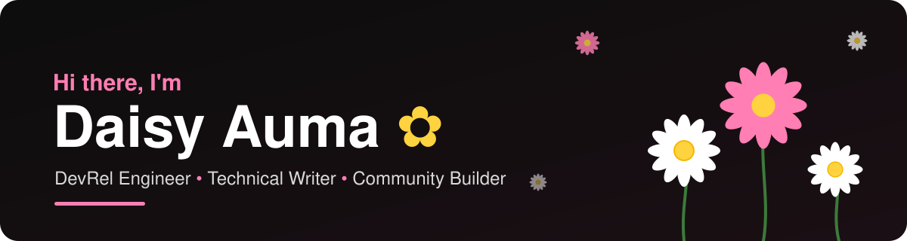

<!--
  ✿ Hi! Thanks for peeking at the source. Feel free to borrow ideas.
-->

<p align="center">
  
</p>

<p align="center">
  <a href="https://git.io/typing-svg">
    
  </a>
</p>

<p align="center">
  
  
</p>

---

## Overview

I'm a **Developer Relations Engineer and Technical Writer**. I help developers go from "what is this?" to their first successful request as fast as possible.

I've documented foundation models, AI APIs, SLAM tooling and one of Africa's biggest payment APIs. I also co-founded **[LuxDevHQ](https://www.luxdevhq.ai/)**, a pan-African AI and data science bootcamp with **20,000+ members across 16 countries**.

## Quickstart

```bash
$ npx meet-daisy

✿ role        DevRel Engineer · Technical Writer
✿ community   Co-founder & Programme Lead @ LuxDevHQ
✿ studying    MSc Data Science, University of East London
✿ teaching    SQL, Python and data science to 200+ students
✿ ambassador  Women Techmakers · Google Developer Groups
✿ ask me      docs strategy, API onboarding, AI/ML, building communities
```

## Changelog

| Version | Where | What shipped |
| :-- | :-- | :-- |
| `2025.09` | **Archetype AI** | Senior Developer Advocate & sole technical writer for Newton, a physical AI foundation model |
| `2024.05` | **Cloudflare** | Docs for AI models, plus A/B tests on task completion, time to first request and support tickets |
| `2022.10` | **Kudan** | DevRel for mobile mapping and SLAM (C++, ROS) |
| `2021` | **LuxDevHQ** | Co-founded a bootcamp community that now spans 16 countries |
| `2020.10` | **Safaricom** | M-PESA Daraja API, supporting a 10,000+ developer community |

## Featured work

| Project | What it does |
| :-- | :-- |
| [**ship-it-commons**](https://github.com/Daisy-Faith-Auma/ship-it-commons) | Can a developer ship it? A deployability audit of African-language models on Hugging Face |
| [**regs-rag**](https://github.com/Daisy-Faith-Auma/regs-rag) | RAG assistant over the FIA Formula E sporting regulations |
| [**docs-ab-testing-simulation**](https://github.com/Daisy-Faith-Auma/docs-ab-testing-simulation) | Simulating how A/B tests measure documentation quality |
| [**trendline**](https://github.com/Daisy-Faith-Auma/trendline) | My Reddit Game of the Day hackathon entry |
| [**uk-housing-affordability-tracker**](https://github.com/Daisy-Faith-Auma/uk-housing-affordability-tracker) | Housing affordability across England and Wales |

## API reference (a.k.a. my toolbox)

<p>
  
</p>

Also fluent in: SQL, Power BI (DAX, Power Query), Databricks, q/kdb+, Hugging Face, docs-as-code.

## Latest writing

<a href="https://medium.com/@daisyfaithauma"></a>

I write tutorials on AI, APIs and developer tools. Talks and walkthroughs live on [YouTube @Daisy_codes](https://youtube.com/@Daisy_codes).

## Git garden

<p align="center">
  
</p>

<p align="center"><sub>A pixel bonsai grown from my commit history. It regrows daily, so every commit counts ✿ Made with <a href="https://github.com/egorthinks/git-bonsai">git-bonsai</a>.</sub></p>

## Contributing (let's connect)

<p>
  <a href="https://daisy-faith-auma.netlify.app"></a>
  <a href="https://linkedin.com/in/daisyfaithauma"></a>
  <a href="https://medium.com/@daisyfaithauma"></a>
  <a href="https://youtube.com/@Daisy_codes"></a>
  <a href="https://x.com/daisyfaithauma"></a>
</p>

> [!TIP]
> **Hiring for DevRel or technical writing?** See my work and resume on my [portfolio](https://daisy-faith-auma.netlify.app), or say hi on [LinkedIn](https://linkedin.com/in/daisyfaithauma).
>
> **Part of the community?** Come learn with us at [LuxDevHQ](https://www.luxdevhq.ai/) ✿

<p align="center">
  
</p>
